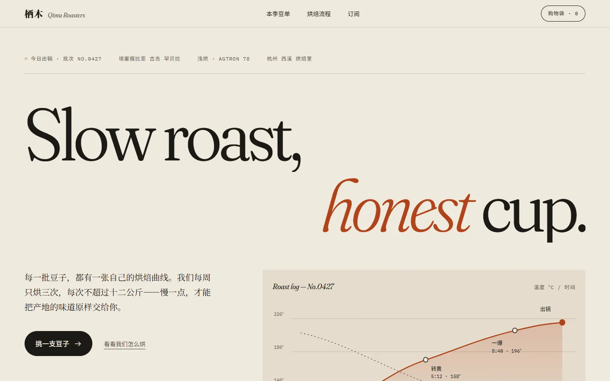
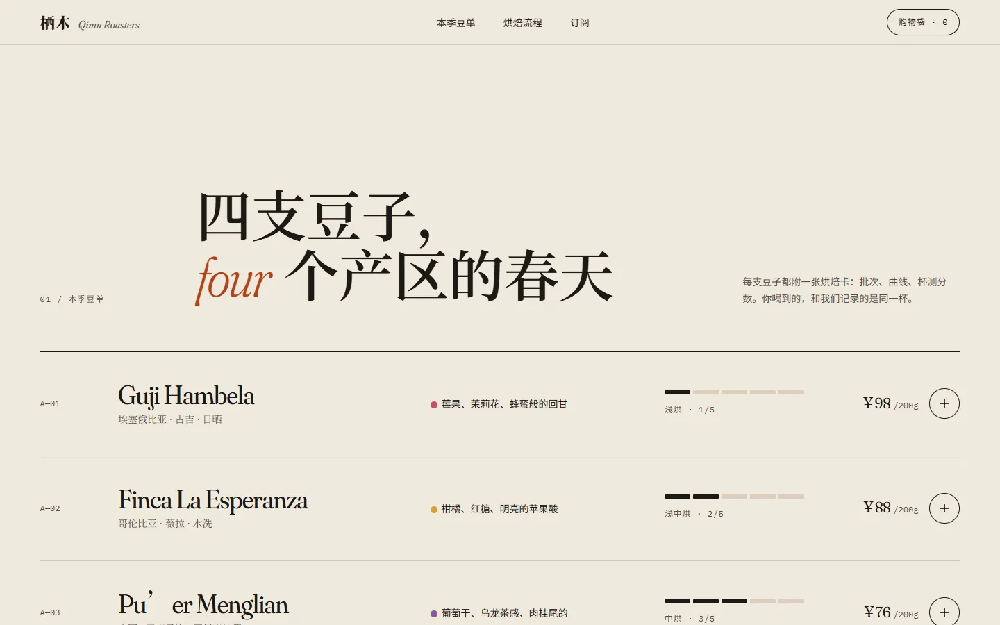
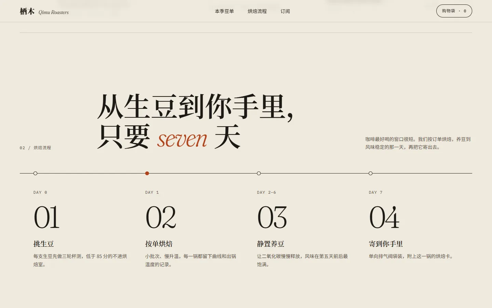
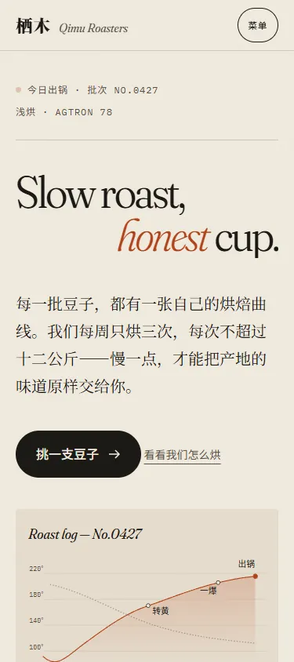
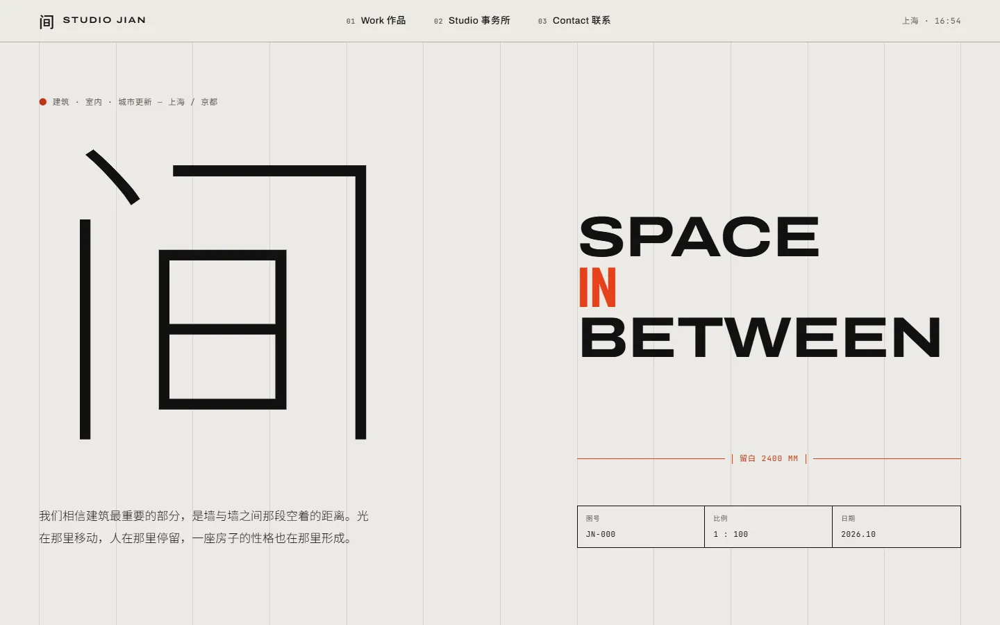
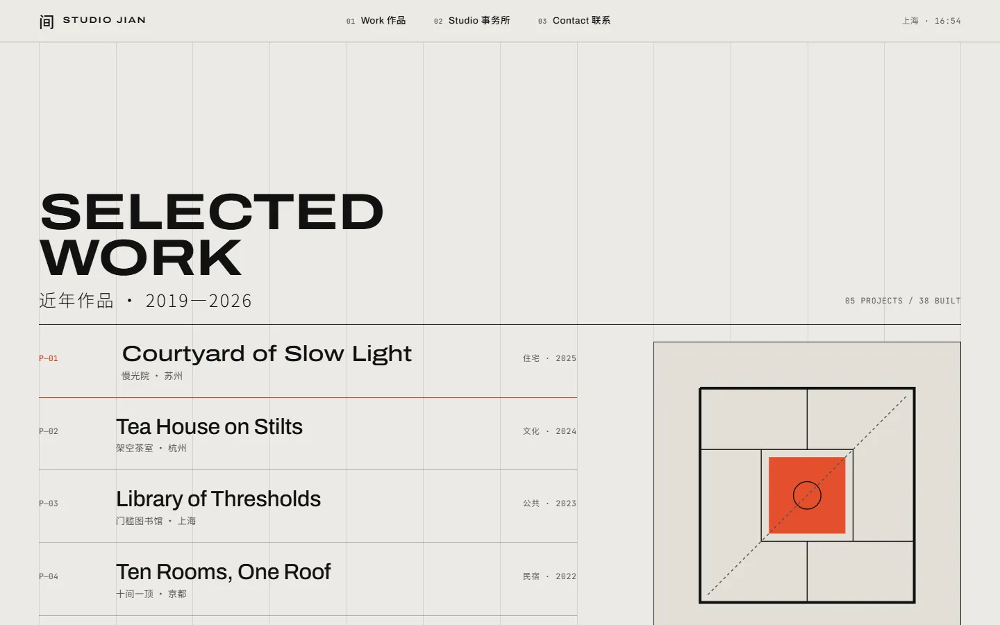
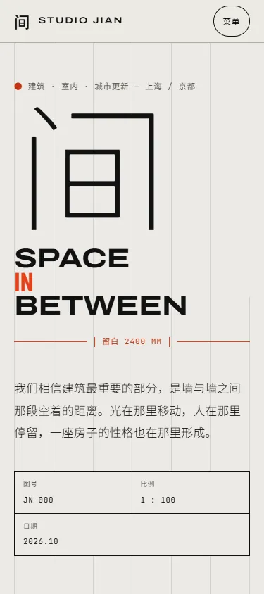
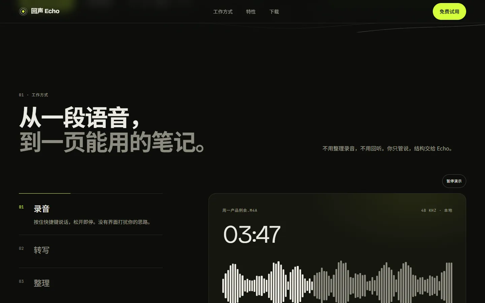
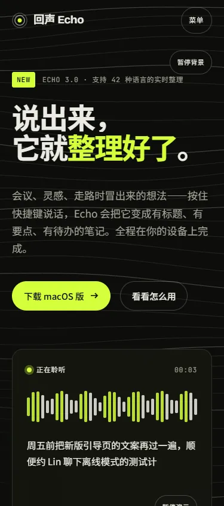

# award-level-web-design

一个让 AI 编程助手按 **Awwwards / Webby Awards / FWA 获奖网站**的品质标准来设计和实现网页的 Agent Skill。

页面完成后，它会实际渲染并截图，再从九个维度逐项打分、修改、重新截图，循环到没有明显可提升之处：

> 排版 · 留白 · 视觉层级 · 色彩 · 动效 · 微交互 · 响应式 · 原创性

**在线主页与示例：https://abc-xiaoxuan.github.io/award-level-web-design/**

遵循开放的 [Agent Skills](https://agentskills.io) 格式，可用于 Claude Code、Codex、Cursor 等支持 skill 的工具。

## 效果示例

下面三个页面都是用这个 skill 生成的，每个都经过了多轮"截图—打分—修改"的自检。源码在 [`examples/`](examples)，共享的菜单、动效控制和本地字体在 [`assets/`](assets)。下载完整仓库后可直接打开 HTML；本地预览与验证方法见下文。

手机和平板有全屏导航；评分卡和 Echo 演示提供暂停按钮，也会在悬停、键盘聚焦、切换到后台时暂停。示例使用本地字体，无需连接 Google Fonts。

### 栖木咖啡 · 独立烘焙品牌
概念"一张烘焙记录卡"：暖纸色 + Fraunces 衬线；签名时刻是一条自动绘制、可拖动查看任意时刻温度的烘焙曲线。



| 本季豆单 | 烘焙流程 | 手机端 |
|---|---|---|
|  |  |  |

### 间 Studio Jian · 建筑事务所
概念"图纸即界面"：可见的 12 栏发丝网格、尺寸标注线和图签；悬停项目时显示对应平面图，鼠标是一个带坐标读数的十字准线。



| 作品索引 | 手机端 |
|---|---|
|  |  |

### 回声 Echo · AI 语音笔记
概念"声音留下的等高线"：暗色 + 酸性绿；背景等高线会绕开鼠标弯曲，下方是自动轮播的"录音 → 转写 → 整理"交互演示。


| 工作方式演示 | 手机端 |
|---|---|
|  |  |

## 安装

### 方式一：npx（支持 Claude Code、Codex 等 30+ 工具）

```bash
npx skills add ABC-xiaoxuan/award-level-web-design
```

安装到用户全局目录（所有项目可用）：

```bash
npx skills add ABC-xiaoxuan/award-level-web-design -g
```

只装给某个工具，例如 Claude Code 和 Codex：

```bash
npx skills add ABC-xiaoxuan/award-level-web-design -g -a claude-code -a codex
```

### 方式二：Claude Code 插件市场

在 Claude Code 里依次输入：

```
/plugin marketplace add ABC-xiaoxuan/award-level-web-design
/plugin install award-level-web-design@award-level-web-design
```

### 方式三：手动复制

把 `skills/award-level-web-design/` 整个文件夹复制到：

| 工具 | 目录 |
|---|---|
| Claude Code | `~/.claude/skills/` |
| Codex | `~/.agents/skills/` |

## 使用

装好后不用特意调用。当你让 AI 做落地页、官网、作品集、产品页，或者提到"高级感""设计感""别像模板""Awwwards 风格"时，它会自动启用。

也可以显式调用：

- Claude Code：`/award-level-web-design`
- Codex：`$award-level-web-design`

示例：

```
帮我做一个独立咖啡品牌的官网首页，要有高级感
```

## 它会做什么

1. **先定设计概念**：一句话创意、字体搭配、色彩方案、版式网格，以及至少一个"签名时刻"。
2. **实现时守住底线**：设计令牌、只动 transform/opacity 的流畅动效、完整的交互状态、WCAG AA 对比度、`prefers-reduced-motion`、375–1920 四档宽度。
3. **截图 + 自动审计**：自带的 `shoot.mjs` 一次截完 375 / 768 / 1440 / 1920 四个宽度，`audit.js` 自动查出溢出、对比度、点击区、中文字体回退、标题孤字等客观问题。
4. **打分修改循环**：九个维度按锚点打 1–10 分，每个分数附截图证据（含模糊灰度的"眯眼图"和整页缩略图），另开一个只看截图的子 agent 独立复评，再按 Awwwards 的设计 40% / 可用性 30% / 创意 20% / 内容 10% 加权。按影响排序批量修改，再重新截图。默认 2 轮、最多 3 轮；audit 无 error、总分 ≥ 8.5 且没有维度低于 8 即停止。
5. **交付说明**：设计取舍、每轮改了什么、最终得分与 audit 结果、还需要你提供的素材。

截图脚本需要 Node 22+ 和本机的 Chrome / Edge / Chromium。没有的话，可以把 `audit.js` 粘贴到浏览器控制台执行；两者都用不了时，它会改为对照代码逐条审查，并告诉你这一点。

单独使用脚本：

```bash
node skills/award-level-web-design/scripts/shoot.mjs ./index.html --audit --sections "#work" --out shots
```

## 本地预览与验收

需要 Node 22+ 和本机 Chrome，在仓库根目录执行：

```bash
npm ci
npm run dev
# 打开 http://127.0.0.1:4173
```

```bash
npm test                 # 四个页面 × 四档宽度、菜单键盘操作、暂停/恢复、图片预算、分享标签
npm run test:lighthouse  # 默认移动端模拟节流，四项分数低于 95 会失败
```

两项检查顺序运行，避免多个浏览器争用资源影响性能结果。报告保存在 `verification/`，验收口径和本轮结果见 [`verification/REVIEW.md`](verification/REVIEW.md)。

修改页面后可重建展示资源：

```bash
python -m pip install fonttools brotli pillow
npm run build:fonts      # 从仓库内的原始字体提取页面子集，不访问外网
npm run build:share      # 生成 1200×630 分享图
npm run build:previews   # 截取三个示例，生成 WebP 与 480/960 宽度版本
```

保留 `assets/fonts/` 中的 OFL 许可证。发布 GitHub Pages 时需连同 `assets/`、`examples/`、`favicon.svg` 和 `og-preview.png` 一起发布；上线后再用分享平台调试工具确认抓取并刷新缓存。

## 文件结构

```
skills/award-level-web-design/
├── SKILL.md                      # 主流程
├── references/art-direction.md    # 美术方向、叙事结构与节拍表
├── references/award-criteria.md   # 奖项标准、维度权重与分数锚点
├── references/cjk-type.md         # 中文字体选择、子集化加载、排版细节与竖排
├── references/review-checklist.md # 九维度自检清单
├── references/motion-patterns.md  # 动效模式与降级模板
├── scripts/shoot.mjs              # 多宽度截图 + 调用审计
├── scripts/audit.js               # 页面内自动审计（也可粘贴到控制台）
├── scripts/performance.js         # LCP / CLS 采集（shoot.mjs --perf 使用）
└── agents/openai.yaml             # Codex 界面信息（其他工具会忽略）
examples/                          # 三个示例页面 + 截图（不会被安装）
```

## 许可证

[MIT](LICENSE)
